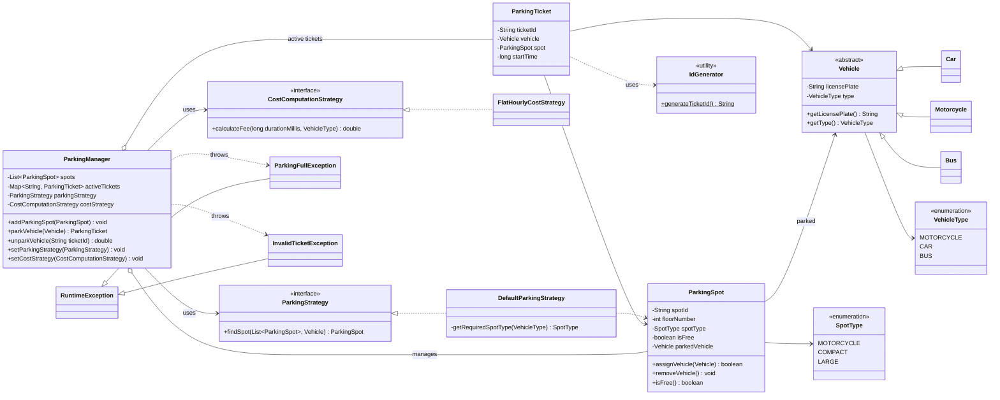

# Parking Lot System

A smart, multi-floor parking lot system written in plain Java (no external dependencies). It issues tickets when vehicles enter, assigns them a suitable spot, and calculates the fee when they leave. Spot-allocation and pricing logic are pluggable through the Strategy pattern.

## Features

- Multi-floor parking structure with typed spots (`MOTORCYCLE`, `COMPACT`, `LARGE`)
- Supports motorcycles, cars and buses
- Ticket generation with unique IDs (`TCK-0001`, `TCK-0002`, ...)
- Pluggable spot-allocation strategy (`ParkingStrategy`) and pricing strategy (`CostComputationStrategy`), swappable at runtime
- Thread-safe entry/exit operations
- Custom exceptions for a full lot and for invalid tickets

## How it works

### Vehicle to spot mapping (`DefaultParkingStrategy`)

| Vehicle      | Required spot type |
|--------------|--------------------|
| Motorcycle   | `MOTORCYCLE`       |
| Car          | `COMPACT`          |
| Bus          | `LARGE`            |

The strategy picks the first free spot of the required type.

### Pricing (`FlatHourlyCostStrategy`)

Duration is rounded up to whole hours, with a minimum charge of 1 hour.

| Vehicle    | Rate per hour |
|------------|---------------|
| Motorcycle | ₹10           |
| Car        | ₹20           |
| Bus        | ₹40           |

### Flow

1. **Park**: `ParkingManager.parkVehicle(vehicle)` asks the `ParkingStrategy` for a spot. If none is available it throws `ParkingFullException`. Otherwise it assigns the vehicle to the spot, creates a `ParkingTicket`, stores it as an active ticket and returns it.
2. **Unpark**: `ParkingManager.unparkVehicle(ticketId)` removes the active ticket (throws `InvalidTicketException` if unknown), frees the spot and uses the `CostComputationStrategy` to compute the fee.

> Note: the exit duration is currently mocked to 2 hours in `unparkVehicle` for demonstration. To use real time, compute `System.currentTimeMillis() - ticket.getStartTime()` instead.

### Concurrency

`ParkingManager.addParkingSpot`, `parkVehicle` and `unparkVehicle` are `synchronized` on the same manager instance. This makes the "find a spot, then assign it, then issue a ticket" sequence atomic and protects the non-thread-safe `ArrayList` of spots. `ParkingSpot.assignVehicle/removeVehicle` are also synchronized, and ticket IDs come from an `AtomicInteger`. Use one `ParkingManager` per physical lot and share that instance across threads.

## Project structure

```
src/main/java/com/parkinglot
├── Main.java                      # Demo simulation
├── exception
│   ├── InvalidTicketException.java
│   └── ParkingFullException.java
├── model
│   ├── Vehicle.java (abstract)    # Car, Motorcycle, Bus extend it
│   ├── Car.java / Motorcycle.java / Bus.java
│   ├── VehicleType.java           # enum
│   ├── ParkingSpot.java
│   ├── SpotType.java              # enum
│   └── ParkingTicket.java
├── service
│   └── ParkingManager.java        # Core orchestration
├── strategy
│   ├── ParkingStrategy.java       # Interface
│   ├── DefaultParkingStrategy.java
│   ├── CostComputationStrategy.java  # Interface
│   └── FlatHourlyCostStrategy.java
└── util
    └── IdGenerator.java           # Thread-safe ticket ID generator
```

## UML class diagram



## Design patterns

- **Strategy**: `ParkingStrategy` and `CostComputationStrategy` can be replaced without modifying `ParkingManager` (Open/Closed Principle).
- **Dependency Injection**: strategies are passed through the constructor.
- **Inheritance / Polymorphism**: `Vehicle` base class with `Car`, `Motorcycle` and `Bus`.

## Setup

### Prerequisites

- JDK 11 or newer (developed and tested with JDK 21)
- Git

### Clone

```bash
git clone https://github.com/CodeItKarthik/parking-lot-system.git
cd parking-lot-system
```

### Build and run

```bash
mkdir -p out
javac -d out $(find src/main/java -name "*.java")
java -cp out com.parkinglot.Main
```

Alternatively, open the project in IntelliJ IDEA (or any Java IDE), mark `src/main/java` as the sources root and run `com.parkinglot.Main`.

## Sample output

```
--- Starting Parking Lot Simulation --- 

Parked CAR [KA-01-MA-1234] at Spot C-102 (Floor 1). Ticket ID: TCK-0001, Parked time: 24-Oct-2026 08:01:11 pm
Parked MOTORCYCLE [KA-03-EX-9999] at Spot M-101 (Floor 1). Ticket ID: TCK-0002, Parked time: 24-Oct-2026 08:01:11 pm
Parked BUS [MH-12-TR-5555] at Spot L-103 (Floor 1). Ticket ID: TCK-0003, Parked time: 24-Oct-2026 08:01:11 pm
Parked CAR [DL-01-CA-5678] at Spot C-201 (Floor 2). Ticket ID: TCK-0004, Parked time: 24-Oct-2026 08:01:11 pm
Parking Full for Vehicle Type: CAR

--- Simulating Exit Process (Mocked 2 Hours Duration) --- 

Unparked KA-01-MA-1234 from Spot C-102. Total Fee: ₹40.0
Unparked KA-03-EX-9999 from Spot M-101. Total Fee: ₹20.0

--- Trying to park the blocked vehicle again --- 

Parked CAR [UP-16-NZ-0001] at Spot C-102 (Floor 1). Ticket ID: TCK-0005, Parked time: 24-Oct-2026 08:01:11 pm
```

## Extending the system

- **New allocation rule** (e.g. nearest-to-entrance, lowest floor first): implement `ParkingStrategy` and call `setParkingStrategy(...)`.
- **New pricing model** (e.g. peak/off-peak, per-minute): implement `CostComputationStrategy` and call `setCostStrategy(...)`.
- **New vehicle type**: add a value to `VehicleType`, a `Vehicle` subclass, and update the mappings in the strategies.
